<a href="https://deceroai.com">
  <picture>
    <source media="(prefers-color-scheme: dark)" srcset="assets/banner-dark.svg">
    <source media="(prefers-color-scheme: light)" srcset="assets/banner-light.svg">
    
  </picture>
</a>

  
  
  
  

DeCeroAI Solutions takes AI from prototype to production: governed semantic layers, production agents with real identity and guardrails, and the security and observability that keep them accountable. Every engagement is led hands-on by [Michael DeCero](https://github.com/madecero), embedded with your team from architecture through deployment.

### How the work runs

<table>
  <tr>
    <th align="left" width="33%">🗺️ 01 · Map the reality</th>
    <th align="left" width="33%">🧱 02 · Build the data spine</th>
    <th align="left" width="33%">🛡️ 03 · Ship with guardrails</th>
  </tr>
  <tr valign="top">
    <td>Understand the actual workflow: where decisions stall, where data breaks, and what a person does today that an agent should handle tomorrow.</td>
    <td>Model facts, dimensions, and metrics so AI has stable, governed context it can query and trust.</td>
    <td>Production agents in the tools teams already use, deployed with security, observability, evals, and audit from day one.</td>
  </tr>
</table>

### Selected work

<table>
  <tr valign="top">
    <td width="50%">
      <a href="https://deceroai.com/work/enterprise-semantic-layer"><b>Enterprise semantic layer</b></a> 
      70+ Snowflake databases unified into governed semantic views with 150+ metrics
    </td>
    <td width="50%">
      <a href="https://deceroai.com/work/multi-tool-agent-platform"><b>Multi-tool agent platform</b></a> 
      A Slack-native agent with 84 tools across 13 SaaS surfaces, on Kubernetes
    </td>
  </tr>
  <tr valign="top">
    <td>
      <a href="https://deceroai.com/work/agent-security-architecture"><b>Agent security architecture</b></a> 
      Action firewall, taint propagation, deny-by-default egress, pinned identity
    </td>
    <td>
      <a href="https://deceroai.com/work/private-cloud-platform"><b>Private-network cloud platform</b></a> 
      Front Door and WAF over Private Link, deny-by-default egress, all as code
    </td>
  </tr>
  <tr valign="top">
    <td>
      <a href="https://deceroai.com/work/self-service-analytics-agent"><b>Self-service analytics agent</b></a> 
      A Claude Code plugin with 11 domain skills over a governed semantic layer
    </td>
    <td>
      <a href="https://deceroai.com/work/data-observability"><b>Data observability</b></a> 
      69 feeds and jobs judged every 5 minutes, one email per incident
    </td>
  </tr>
</table>

Client work stays confidential, so the write-ups cover the architecture and the controls. Each one has a diagram at <a href="https://deceroai.com/work">deceroai.com/work</a>.

📓 **Field notes:** [Making an AI-assisted platform commercial grade](https://deceroai.com/work/prototype-to-production), the PR gate, OIDC deploys, private network, append-only data, and detection that let an AI-assisted build carry paying customers.

### Open source

🚧 Projects land here as they are ready. Each one ships with tests, CI, docs, and a security pass before its first release.

de0, LLC d/b/a DeCeroAI Solutions &#183; Waunakee, Wisconsin &#183; <a href="https://deceroai.com/contact">deceroai.com/contact</a>

